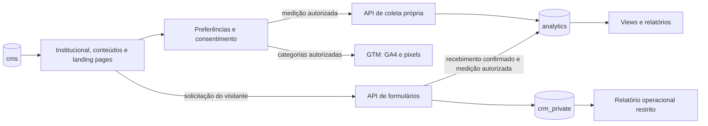

# Bomfim — estrutura de análise e banco de dados v1

Documento de entrega à equipe de backend · 19/10/2026 · Python + PostgreSQL 14+

## Definição da entrega entre equipes

- **Equipe atual:** finalizar o frontend React/Vite, seus fluxos e estados demonstrativos, conteúdo, imagens e documentação técnica.
- **Equipe destinatária:** implementar o backend em **Python**, gestão do CMS, APIs, persistência PostgreSQL, segurança, integrações e operação em produção.
- O frontend será entregue com o código-fonte, instruções de execução/build, catálogo de páginas e formulários, contratos de integração e proposta SQL. Os contratos independem do framework Python escolhido pela equipe destinatária.
- Não implementar backend, criar banco, ativar processamento real de formulários ou instalar infraestrutura nesta etapa. Não adicionar um backend temporário em outra linguagem.
- O modelo SQL e as interfaces deste documento são referências de implementação para a outra equipe. Migrações, driver/ORM, framework Python, autenticação do CMS e deploy serão definidos por ela.
- Antes da transferência, distinguir claramente os estados de demonstração dos estados que dependerão de resposta real da API. A conclusão visual de formulário não confirma recebimento comercial.

## 1. Objetivo e estado da entrega

O site é institucional, com conteúdo editorial, ferramentas de planejamento e áreas de conversão. As landing pages de mídia ficam no mesmo projeto, mas precisam de relatórios próprios. O portal operacional Bomfim é outro software: não será incluído no banco nem terá suas sessões unificadas com este site.

**Entregáveis:** [modelo SQL](database/001_initial_schema.sql), [dicionário de medição](medicao-e-relatorios.md) e [consultas iniciais](database/002_analysis_queries.sql). O SQL é uma proposta para revisão/migração; **nenhum banco ou servidor foi criado ou alterado**. Não foram instalados GTM, GA4 ou pixels nesta atividade.

### Situação encontrada no frontend

- React/Vite com navegação SPA, quatro campanhas em `/campanhas/` e artigos em `/conteudos/:slug`.
- Rotas de obrigado existentes: contato, cotação, coleta, conteúdos e denúncia. Formulários comerciais e modal de rotas ainda não confirmam recebimento de backend.
- Ausência de GA4, GTM e coletor próprio. O consentimento é demonstrativo; está desabilitado nas landing pages e precisa abranger também essas páginas antes da ativação das tags.
- Nome, empresa, telefone e e-mail podem ser lembrados localmente por 30 dias; esse recurso não deve fornecer dados ao analytics. Não existe login institucional.
- Descrições de SEO ainda genéricas e imagens reutilizadas: a futura revisão editorial deverá alimentar o catálogo CMS, sem exigir alterações nos componentes para cada publicação.

## 2. Arquitetura proposta

### Separação de responsabilidade

| Schema | Dados | Quem acessa |
|---|---|---|
| `cms` | Páginas, metadados, imagens, campanhas, formulários e destinos de obrigado | CMS e backend de publicação |
| `analytics` | Navegadores pseudônimos, consentimento, sessões, visualizações, eventos e conversões | Coletor e consultas agregadas de marketing |
| `crm_private` | Nome, empresa, WhatsApp, e-mail, detalhes da operação e status de solicitações | Backend de formulários e equipe autorizada |

O navegador não acessa PostgreSQL diretamente. As APIs serão implementadas pela equipe destinatária em Python, mantendo a separação dos três schemas. O desenvolvedor deve criar roles separadas: migração, publicação CMS, ingestão, atendimento e leitura de relatórios. Aplicar menor privilégio, grants por tabela e views para relatórios; o SQL inicial não provisiona usuários nem senhas. Nenhuma role de relatório recebe acesso a `crm_private`.

## 3. Modelo inicial

| Tabela | Unidade de registro | Uso |
|---|---|---|
| `cms.assets` | Arquivo visual existente | Caminho, texto alternativo e dimensões |
| `cms.pages` | URL publicada | Área, tipo, H1, título SEO, descrição, imagem principal/social, status e conteúdo |
| `cms.campaigns` | Campanha editorial/de mídia | Landing, etapa do funil e público pretendido |
| `cms.forms` | Tipo de formulário | Contato, cotação, coleta, planejamento de rotas ou newsletter |
| `cms.conversion_destinations` | Formulário + contexto/campanha | Página de obrigado correspondente |
| `analytics.visitors` | Navegador com medição autorizada | ID aleatório; não identifica uma pessoa |
| `analytics.consent_receipts` | Escolha/revogação | Categorias, versão da política e momento |
| `analytics.sessions` | Visita | Ambiente, origem de aquisição, campanha, dispositivo e declaração de cliente |
| `analytics.page_views` | Visualização de uma rota | Área, tipo, tempo ativo e profundidade de leitura |
| `analytics.events` | Interação permitida | CTA, formulário, conteúdo, rotas e saída para atendimento |
| `analytics.conversions` | Recebimento confirmado | Formulário, sessão, campanha e token de deduplicação |
| `crm_private.requests` | Solicitação recebida | Dados pessoais e contexto operacional restritos |

UUIDs usam `gen_random_uuid()`. Datas são `timestamptz`; relatórios agrupam por `America/Sao_Paulo`. `cms.pages.updated_at` deve ser atualizado pelo backend em cada edição. Não há gestão de fretes, faturas, senhas de clientes ou denúncias neste modelo.

### Preparação para o CMS

- Identificador estável de página, `path` único e classificação: `institutional`, `content`, `landing`, `conversion`, `utility`.
- Para cada página pública, cadastrar título SEO, H1, descrição, imagem principal e social do acervo existente; imagem decorativa usa alt vazio. Priorizar visuais distintos e adequados ao assunto; não impor imagem a páginas utilitárias que não precisam dela.
- `content` em JSONB armazena blocos editoriais, não scripts, tags arbitrárias ou dados pessoais. O backend valida cada tipo de bloco e sanitiza HTML.
- Páginas de obrigado, revisão da agência, biblioteca visual, design system e homologação ficam fora da indexação. O esquema não cria autenticação de editores: usar a solução do CMS escolhido.
- A revisão dos títulos, descrições e seleção de imagens foi aplicada ao frontend de homologação em 19/10/2026. Consulte a [matriz editorial de 77 URLs](revisao-editorial-paginas.md), com exportações CSV e JSON para o CMS.

## 4. Fluxos e contratos mínimos para o backend

### Navegação e sessão

1. Antes do consentimento, não criar identificador persistente de analytics nem enviar eventos ao coletor próprio. Manter somente funções necessárias ao serviço solicitado.
2. Após autorizar medição, gerar ID aleatório por navegador e iniciar sessão. Nova sessão após 30 minutos de inatividade; mudança de UTM não encerra uma sessão em andamento.
3. Cada mudança real de pathname cria uma visualização. Alterações de filtro/hash no planejador não geram novas page views. Back/forward e reload podem criar novas visualizações; retry do mesmo envio não pode duplicá-las.
4. Salvar área de entrada na sessão e área visitada em cada visualização. Uma visita pode passar da landing para conteúdo e institucional sem perder a origem inicial.
5. Registrar tempo só com documento visível e ativo; pausar em segundo plano. Atualizar o mesmo registro por checkpoint cumulativo, com valores monotônicos, sem somar retransmissões.

### Interfaces propostas — ainda não implementadas

| Interface | Responsabilidade |
|---|---|
| `POST /api/v1/consents` | Registrar escolha/versionamento, conceder ou revogar categorias |
| `POST /api/v1/analytics/batch` | Receber sessão, visualizações e eventos tipados; validar IDs, consentimento, limites e deduplicação |
| `POST /api/v1/requests` | Validar e persistir solicitação comercial/newsletter com chave de idempotência |
| `GET /api/v1/reports/*` | Futuro acesso autenticado a dados agregados; não expor tabelas públicas |

A API de coleta usa listas permitidas de campos e eventos. O servidor verifica que recibo, sessão e visualização pertencem ao mesmo navegador, que há autorização de medição válida no momento da coleta e que os IDs de páginas/formulários existem. Essas regras não são resolvidas apenas pelas chaves estrangeiras do SQL.

### Formulários e obrigado

- Enviar dados pessoais apenas à API comercial, nunca ao `dataLayer`. Consentimento para contato não equivale a consentimento para analytics ou publicidade.
- Persistência bem-sucedida retorna `request_id`, confirmação e destino de obrigado escolhido pelo servidor. Usar o `request_id` opaco como `submission_token` para deduplicação, sem FK pública para dados pessoais.
- Se medição estiver autorizada, registrar conversão no contexto da sessão. Se recusada, a solicitação continua sendo recebida normalmente em `crm_private`, sem criar sessão/conversão analítica.
- Pixel e evento GA4 de sucesso dependem do recibo confirmado, nunca só do pathname de obrigado. Refresh, back/forward ou abertura direta da URL não geram nova conversão. Reenvios usam a mesma chave de idempotência.
- Enquanto o backend não existir, nenhuma validação local ou sucesso demonstrativo gera conversão real.
- Destinos: `/obrigado/contato`, `/obrigado/cotacao`, `/obrigado/coleta`, `/obrigado/rotas`, `/obrigado/conteudos`; campanhas: `/campanhas/:campanha/obrigado/:tipo`. Criar os destinos ainda inexistentes no frontend quando implementar o fluxo.
- As páginas podem compartilhar componente visual. Tags são configuradas por `conversion_type` + campanha + contexto, sem colocar IDs de pixels no texto editorial. Denúncias ficam fora de remarketing e das conversões comerciais.

## 5. Públicos, consentimento e ativação

**Default por falta de definição anterior:** não chamar visitante desconhecido de “não cliente”. Adotar `unknown`, `declared_customer`, `declared_prospect`, `confirmed_customer`. Declaração opcional “Já é cliente Bomfim?” pode alimentar o backend; confirmação depende de CRM. Clique no portal/rastreio é apenas intenção de atendimento. Ausência de login não permite reconhecer a mesma pessoa entre dispositivos.

- Status registrado como fotografia da sessão; não reclassificar visitas antigas automaticamente. Uma futura integração CRM atualiza a próxima sessão somente com base e autorização adequadas.
- Públicos propostos: interessados em conteúdo; interessados em rotas; abandono de formulário; declaração de cliente; declaração de prospect; intenção de atendimento; convertidos recentes. Usar janelas iniciais de 30 dias, configuráveis nas plataformas.
- Excluir convertidos das campanhas de aquisição quando apropriado. Excluir clientes confirmados de aquisição de novos clientes; não excluir desconhecidos por inferência.
- Um GA4 para a jornada completa do site e landings, com dimensões de contexto; dashboards separados. Portal externo não usa cross-domain tracking nesta v1.
- GTM centraliza GA4 e tags de mídia. Nenhum ID de produção presumido. Homologação fica separada, sem pixels de produção.
- Consentimento deve funcionar também nas landing pages e permitir medição e marketing separadamente. Default conservador: tags opcionais bloqueadas até autorização da categoria; revogação interrompe novas coletas e limpa identificadores opcionais controlados pelo site. A gestão das tags deve respeitar Consent Mode.
- Não transmitir nomes, e-mails, telefones, CNPJ/CPF, códigos de carga, mensagens, URLs com esses dados, IP bruto ou user agent bruto ao analytics. Não usar e-mail com hash como substituto do visitante anônimo.
- Dados com ID de navegador são **pseudônimos**, não plenamente anônimos. Não usar fingerprinting. Autopreenchimento local de contato permanece separado da identificação analítica; oferecer opção de apagar e revisar sua preferência de armazenamento antes do lançamento.

### Retenção inicial para discussão de lançamento

| Dado | Default proposto |
|---|---|
| Contato para autopreenchimento no navegador | 30 dias, já existente |
| Sessões, eventos e visualizações brutas | 90 dias |
| Visitante sem atividade | Remover após 90 dias, respeitando a exclusão encadeada dos dados analíticos |
| Recibos de consentimento | Prazo aprovado pela governança antes de produção; não definir guarda perpétua por omissão |
| Solicitações comerciais | Prazo aprovado por Comercial e governança antes da produção |

Criar rotina de expurgo transacional e fluxo restrito de exclusão. Não executar expurgo nem publicar coleta real como parte desta documentação.

## 6. Entrega e critérios de aceite

1. Pela equipe de backend Python: revisar SQL em banco descartável; só depois transformar em migração versionada e aplicar no ambiente de desenvolvimento.
2. Cadastrar acervo visual, páginas, campanhas e formulários atuais. Fazer matriz URL → H1/SEO/imagens → área → conversão → obrigado antes da implementação editorial.
3. Implementar APIs com validação, rate limiting, idempotência e separação de roles; nenhuma escrita pública direta no banco.
4. Implementar eventos na SPA e consentimento compartilhado entre institucional e landings. Um único responsável por page view no GA4, evitando envio automático e manual duplicados.
5. Validar relatório de aquisição, navegação entre áreas, leitura, funil e conversão com dados sintéticos; conferir duplicação, mudança de consentimento e recusa.
6. Ativar IDs reais somente após homologação. A interface operacional de relatórios permanece decisão de produto: v1 entrega consultas e contrato de dados para GA4/Looker Studio ou futuro CMS.

**Cenários de aceite:** institucional → conteúdo → formulário; landing → formulário → obrigado; retorno após 30 minutos; duas abas; artigo em segundo plano; refresh do obrigado; retry de evento/solicitação; envio sem consentimento analítico; revogação; acesso ao portal externo; ambiente de testes excluído dos relatórios de produção; denúncia fora da medição comercial; usuário desconhecido nunca rotulado automaticamente como prospect.

### Referências técnicas

- [Medição de SPA no GA4](https://developers.google.com/analytics/devguides/collection/ga4/single-page-applications)
- [Consent Mode](https://developers.google.com/tag-platform/security/concepts/consent-mode)
- [Evitar informações pessoais no Analytics](https://support.google.com/analytics/answer/6366371/)

## Atualização de experiência de conclusão — 19/10/2026

- O modal de rotas não pede aceite obrigatório e não exibe o texto de autopreenchimento. A explicação e exclusão do contato salvo ficam em Preferências de cookies.
- `contact_consent` passa a aceitar NULL: ausência do checkbox não pode ser registrada como aceite. A equipe responsável deverá definir/documentar a base de tratamento do contato solicitado; consentimentos de analytics e marketing continuam independentes.
- Formulários de contato, cotação, coleta e rotas levam à sua tela de obrigado após validação demonstrativa. As campanhas preservam o identificador no caminho `/campanhas/:campaign/obrigado/:kind`.
- A tela de obrigado ocupa o viewport, sem header, rodapé ou alerta de entrega. Celebração por aproximadamente 2 segundos, sem som; o canal de denúncias não exibe confetes. Movimento reduzido desativa a animação.
- Após 5 segundos visíveis, retorna à home com substituição de histórico e mensagem temporária dentro da interface. O visitante pode voltar imediatamente ou interromper a contagem.
- Nenhum fluxo foi conectado ao backend. Estas telas não são evidência de recebimento real nem disparam conversões. Na integração Python, só concluir como envio recebido depois da confirmação persistida pela API.
